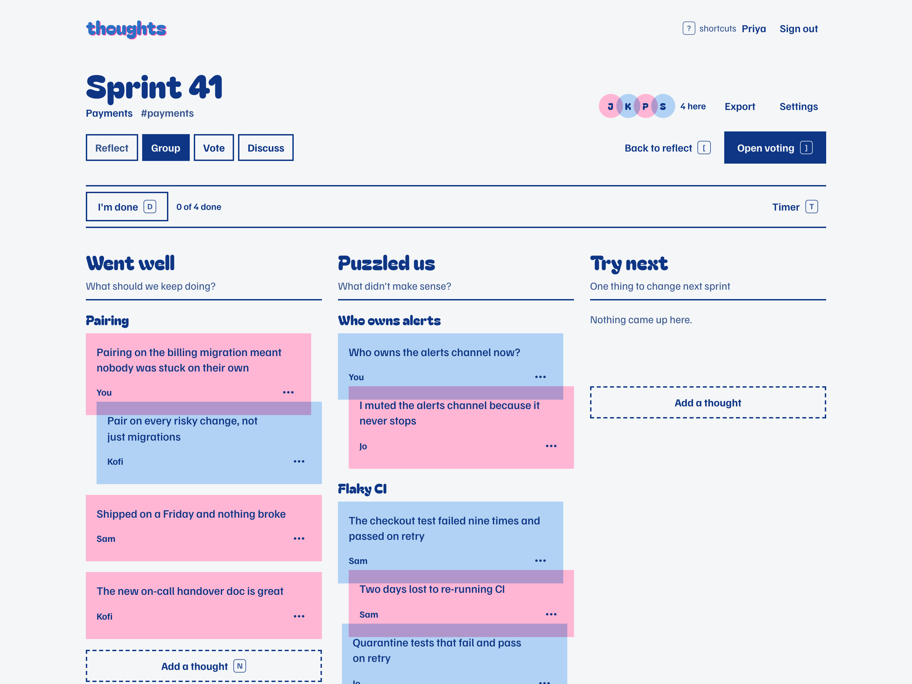
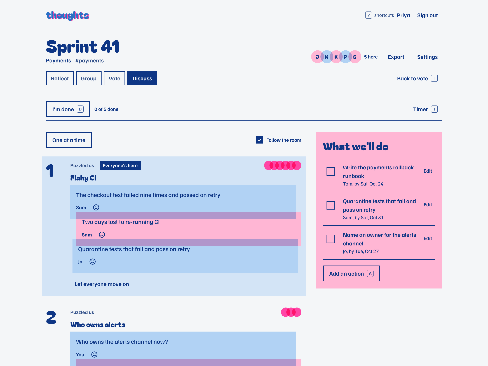
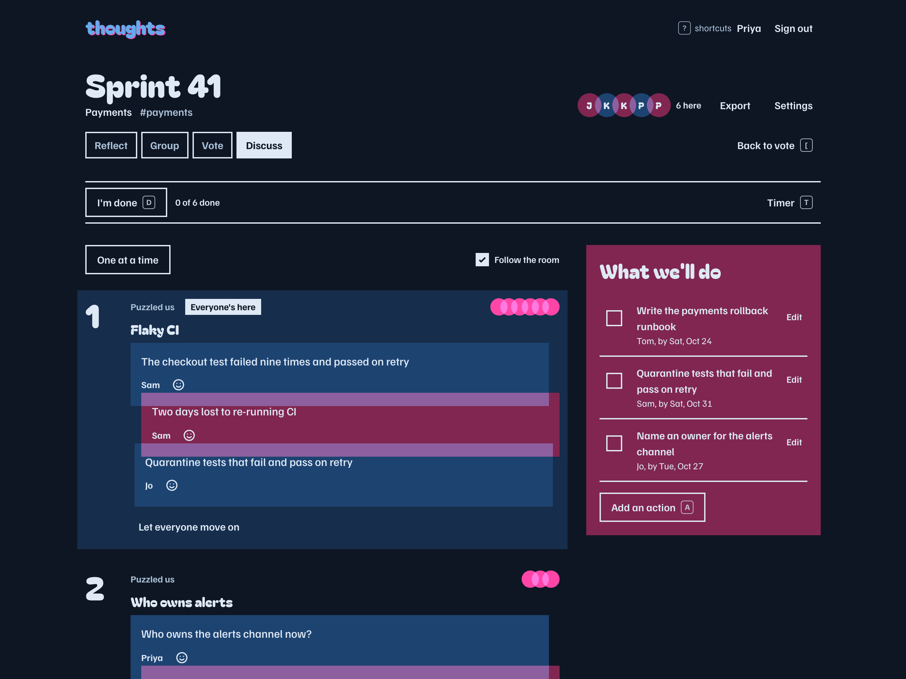
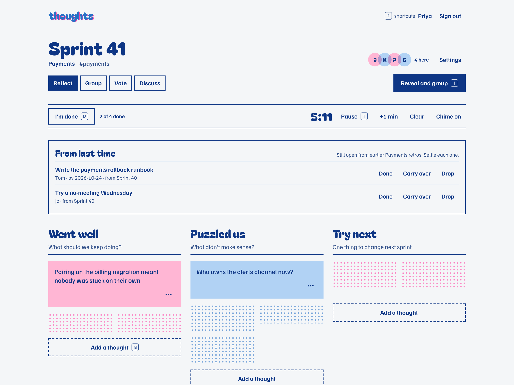
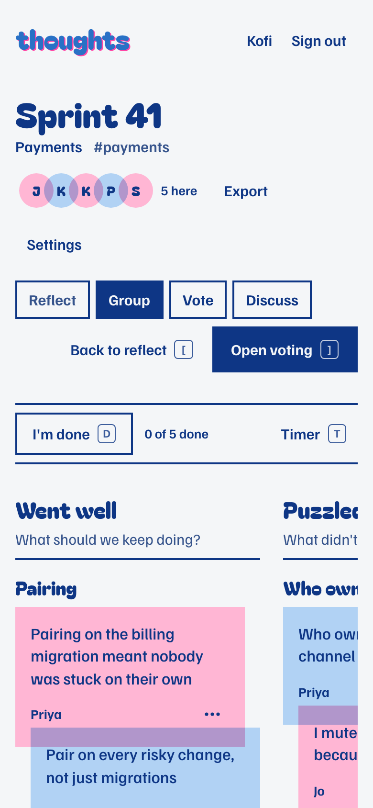

<picture>
  <source media="(prefers-color-scheme: dark)" srcset="docs/brand/logo-dark.svg">
  
</picture>

Retros where everyone writes first and reads later.

thoughts is a self-hosted retrospective board for teams. Everyone writes on
their own, nobody can read anyone else's notes until the room moves on, and
the retro ends with actions that the team's next retro opens with. It's one
small Docker image with SQLite inside, so there's nothing else to run.



## What it does

- **Reflect, group, vote, discuss.** Notes stay hidden, author and all,
  until everyone moves on. Then they're grouped by dragging, or by keyboard,
  and voted on with votes that stack like dot stickers. Discussion takes the
  groups in order of votes.
- **Actions that don't get lost.** A team's next retro opens with what the
  last one left unfinished: tick it off, carry it over or drop it.
- **Run the room together.** A shared timer, an "I'm done" count, and a
  spotlight that brings everyone to the group being discussed. There's no
  host: anyone can do anything.
- **Keys for the common things.** `[` `]` between stages, `a` for an
  action, `t` for the timer. `?` lists them, `⌘K` finds anything else.
- **Sign in your way.** With just a name (the default, as in v1), your
  directory over LDAP with no service account, or any OpenID Connect
  provider.
- **AI if you want it.** Columns for a theme, suggested groups and names,
  drafted actions and a recap, from Anthropic, OpenAI, any OpenAI-compatible
  server, or GitHub Copilot. Suggestions change nothing until someone applies
  them, and the model never sees who wrote what.
- **Markdown export**, GIFs and images on notes, light and dark.

| | |
|---|---|
|  |  |
|  |  |

## Run it

```bash
docker run -p 3000:3000 -v "$PWD/data:/data" ghcr.io/ellgreen/thoughts:2
```

Then open <http://localhost:3000>. Everything thoughts keeps is in
`/data/thoughts.sqlite`; back up that file.

Binaries for Linux, macOS and Windows are on the
[releases page](https://github.com/ellgreen/thoughts/releases) if you'd rather
not use Docker.

### Upgrading from v1

Change the tag to `2` and restart. v2 copies your v1 database, converts it in
one go, and keeps your links and sessions working.
[docs/upgrading.md](docs/upgrading.md) has the details, and how to go back.

## Settings

All settings are environment variables. The common ones:

| Variable | Default | |
|---|---|---|
| `THOUGHTS_ADDRESS` | `localhost:3000` (`:3000` in Docker) | Where to listen |
| `THOUGHTS_DATA_PATH` | `./data` (`/data` in Docker) | Where the database lives |
| `THOUGHTS_TLS_CERT_PATH`, `THOUGHTS_TLS_KEY_PATH` | unset | Serve HTTPS directly |
| `THOUGHTS_AUTH` | `name` | Ways to sign in: any of `name`, `ldap`, `oidc`, in order |
| `THOUGHTS_PUBLIC_URL` | unset | Where people open thoughts; needed for OIDC |
| `THOUGHTS_AI_DRIVER` | unset | `anthropic`, `openai`, `openai-compatible` or `copilot` |
| `THOUGHTS_GIF_API_KEY` | unset | Turns on GIF search ([Klipy](https://klipy.com/developers) by default; `THOUGHTS_GIF_PROVIDER=giphy` for Giphy). Pasting an image link works without it |
| `THOUGHTS_LOG_FORMAT` | `text` (`json` in Docker) | |

More in [docs/sign-in.md](docs/sign-in.md) (LDAP, OIDC) and
[docs/ai.md](docs/ai.md) (AI drivers and what the model sees).

## Develop

You need Go, Node and pnpm, and [Task](https://taskfile.dev).

```bash
task dev           # the API on :3000, rebuilt on change
pnpm --dir ui dev  # the UI on :5173, proxying to the API
task check         # everything CI runs
```

[CLAUDE.md](CLAUDE.md) describes how the code is laid out and the rules it
follows; [docs/](docs) holds the design, decisions and roadmap.

## Licence

GPL-3.0. See [COPYING](COPYING).
